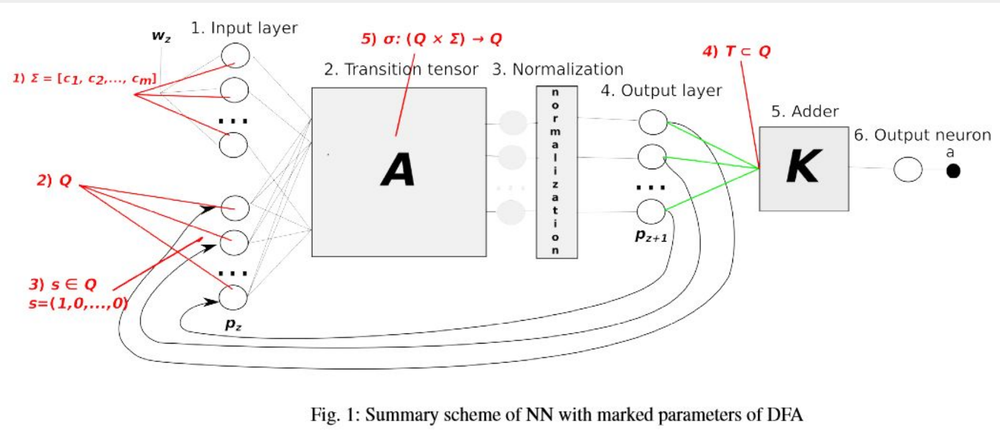
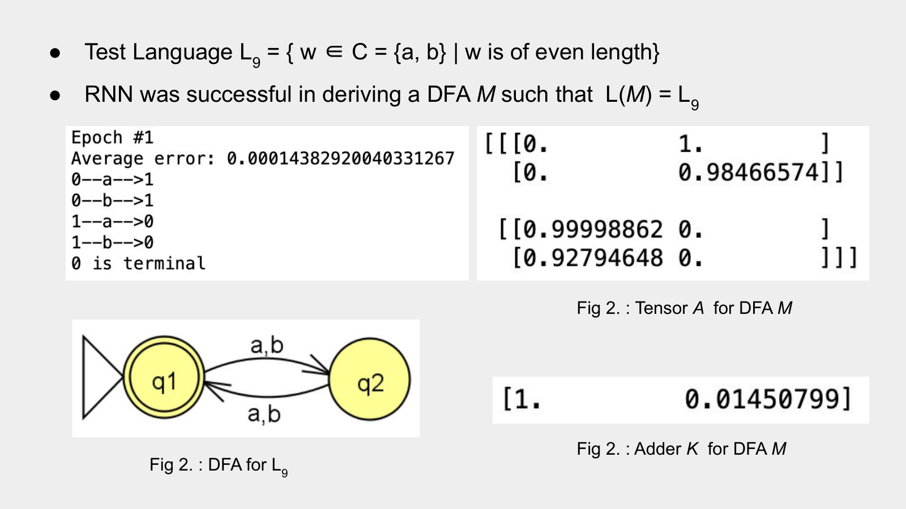

# Neural Network for Synthesizing Deterministic Finite Automata


[](LICENSE)

**Theory of Computation Final Project** · Abhinav Nakarmi, Kuber Shahi

Can a neural network learn a DFA just by looking at labelled words? This repository is a from-scratch NumPy implementation of the recurrent neural network proposed in [*Neural Network for Synthesizing Deterministic Finite Automata*](https://www.sciencedirect.com/science/article/pii/S1877050917323724) (Grachev, Lobanov, Smetannikov, Filchenkov, 2017). Given a list of `(word, accepted?)` pairs for a regular language, the network learns a transition tensor and an accepting-state vector, from which an explicit DFA is read off. We reproduce the paper's architecture and training procedure, build nine test languages, and examine where the method succeeds and where vanishing gradients make it break down.

## Deliverables

| Artifact | Description |
|----------|-------------|
| [Project Intro (PDF)](reports/project_intro.pdf) | Project proposal: problem statement, goals, plan, and technical approach. |
| [Presentation 01 (PDF)](reports/presentation_01.pdf) | Background on DFAs, neural networks, and RNNs, followed by a layer-by-layer walkthrough of the proposed architecture with worked examples. |
| [Presentation 02 (PDF)](reports/presentation_02.pdf) | Training via gradient descent and truncated backpropagation through time, the vanishing-gradient fix, and results on the test languages. |
| [Final Project Summary (PDF)](reports/final_project_summary.pdf) | Intended vs. achieved goals and implementation notes. |
| [`notebooks/rnn_network.ipynb`](notebooks/rnn_network.ipynb) | The full implementation: network, training loop, and DFA extraction. |

## Overview

**Problem statement.**

- **Input:** a regular language $L$, used to generate labelled training tuples `(w, ans)` where `ans = 1` if $w \in L$ and `ans = 0` otherwise. For example, for $L = \lbrace w \in \lbrace a,b \rbrace^* \mid w \text{ has no equal neighbouring characters} \rbrace$, the list is `[(abab, 1), (abaa, 0), ...]`.
- **Output:** a DFA $M$ such that $L(M) = L$.

The network mirrors the five-tuple $(Q, \Sigma, \delta, q_0, F)$ of a DFA: the input layer encodes the alphabet $\Sigma$ and current state $Q$, the start state $q_0$ is fixed to $(1, 0, \dots, 0)$, the transition tensor **A** plays the role of $\delta$, and the adder vector **K** plays the role of the accepting set $F$.



*Figure 1 from Grachev et al. (2017), [CC BY-NC-ND 4.0](https://creativecommons.org/licenses/by-nc-nd/4.0/). Reproduced without modification.*

## Project Structure

```text
.
├── notebooks/
│   └── rnn_network.ipynb        # NumPy implementation of the proposed RNN, training, and DFA extraction
├── dataset/
│   ├── tl{1..9}_generator.py    # Generators for the nine test languages
│   └── tl{1..9}_dataset.txt     # Generated datasets, one "word label" pair per line
├── assets/                      # Figures used in this README
├── reports/
│   ├── project_intro.pdf        # Project proposal
│   ├── presentation_01.pdf      # Background + architecture walkthrough
│   ├── presentation_02.pdf      # Training, backpropagation, and results
│   └── final_project_summary.pdf
├── requirement.txt
├── CREDITS.md                   # Origin and license of every image and artifact
├── LICENSE                      # MIT (original work only)
└── README.md
```

## Network Architecture

The network has two parts: a **recurrent part** that runs once per character of the word, and an **adder** that runs once at the end.

| Layer | Shape | What it does | DFA analogue |
|-------|-------|--------------|--------------|
| **Input layer** | $\lvert C\rvert + \lvert Q\rvert$ | One-hot encoding of the next character, concatenated with the current state vector (a probability distribution over states). | $\Sigma$, $Q$ |
| **Transition tensor A** | $\lvert Q\rvert \times \lvert C\rvert \times \lvert Q\rvert$ | Computes $h_k = \sum_{i,j} A_{kji}\, c_j\, q_i$. $A_{kji}$ is the probability of moving from state $i$ to state $k$ on character $j$. | $\delta$ |
| **Normalization** | $\lvert Q\rvert$ | Rescales $h$ so it sums to 1; the result is fed back as the next current state. | — |
| **Adder K** | $\lvert Q\rvert$ | Computes $a = \langle K, o_w \rangle$ on the final state. $K_i$ is the probability that state $i$ is accepting. | $F$ |
| **Output neuron** | scalar | $a \in [0, 1]$: the probability that $w \in L$. | accept / reject |

Putting it together, for a word $w = w_1 \dots w_n$:

$$
\text{RNN}(w) = \text{Adder}\big(\text{Normalize}(\text{Match}(\dots \text{Normalize}(\text{Match}(q_1, w_1)) \dots, w_n))\big)
$$

After training, the DFA is extracted by taking, for each `(from state, character)` pair, the `to` state with the largest value in **A**, and marking every state with $K_i > 0.5$ as accepting.

## Training

- **Loss:** squared error $L = (y(w) - \text{RNN}(w))^2$.
- **Optimizer:** online stochastic gradient descent, updating **A** and **K** after every word (learning rates `NU = 0.7` for the tensor and `NU * NU_ADDER` for the adder, with weights clipped to $[0, 1]$).
- **Backpropagation through time, truncated:** the full BPTT sum can blow up, so, as in the paper, only the first term of each product is kept.
- **Vanishing-gradient fix:** gradients shrank toward the start of a word, so early characters barely influenced training. The gradient magnitude at the last character is taken as a reference, and every earlier step is rescaled to a fixed multiple of it (`TenzToAdd = 2.0`).
- **Stopping criterion:** train until the average error on a held-out 10% split drops below `EPS = 0.01`.

## Test Languages

Each `dataset/tlN_generator.py` mixes short random strings, valid strings, random longer strings, and *quasi* strings (strings that look valid but are not) so that the network sees hard negatives.

| Language | Alphabet | Definition | Min. DFA states | Samples |
|----------|----------|------------|-----------------|---------|
| **L1** | {a, b} | No two equal neighbouring characters | 4 | 1500 |
| **L2** | {a, b, c} | No two equal neighbouring characters | 5 | 1500 |
| **L3** | {a, b, c} | Length is a multiple of 3 | 3 | 1000 |
| **L4** | {a, b, c} | Contains substring `bac` | 4 | 1000 |
| **L5** | {a, b, c} | Accepted by a fixed 4-state DFA | 4 | 1000 |
| **L6** | {a, b} | Length is exactly 2 or 7 | 9 | 1200 |
| **L7** | {a, b, c} | Contains substring `abacaba` | 8 | 1400 |
| **L8** | {a, b, c, d, e} | Characters are in lexicographic order | 6 | 1000 |
| **L9** | {a, b} | Even length | 2 | 1200 |

State counts include the dead state where one is needed.

## Quick Start

### Install dependencies

```bash
pip install -r requirement.txt
pip install notebook
```

### (Optional) Regenerate a dataset

The generators write to the current directory, so run them from inside `dataset/`:

```bash
cd dataset
python tl1_generator.py   # writes tl1_dataset.txt
```

### Train the network and extract a DFA

```bash
jupyter notebook notebooks/rnn_network.ipynb
```

The notebook is set up for **L9** (even length). To try another language, edit the first two cells:

```python
NUMBER_OF_POSITIONS = 2          # upper bound on the number of states, |Q|
DICTIONARY = ['a', 'b']          # alphabet of the language
f = open('../dataset/tl9_dataset.txt', 'r')
```

Then run all cells. Training prints the average error per epoch, followed by the learned transitions and accepting states, e.g.:

```text
Epoch #1
Average error: 0.00014819284199676973
0--a-->1
0--b-->1
1--a-->0
1--b-->0
0 is terminal
```

Use `nn.run("ababaa")` to classify a new word with the trained network.

## Key Findings

1. **The network recovers the correct DFA for small languages.** L1–L5 and L9 (at most 5 states and 3 characters) all trained below the 0.01 error threshold, and the extracted DFAs accept exactly the target language.
2. **It fails once the DFA gets bigger.** L6 and L7 (8–9 states) and L8 (5-character alphabet) never reached error below 0.01, so no DFA could be extracted.
3. **Vanishing gradients are the main obstacle.** Without the gradient-rescaling fix, characters near the start of a word had almost no effect on the update, and even small languages failed to converge. The fix only partially solves the problem, which is why larger automata remain out of reach.
4. **The learned parameters are directly interpretable.** Unlike a typical black-box network, **A** and **K** converge to near-0/1 values that read as a transition table and an accepting-state set (see the L9 result below).

## Example Result: L9 (Even Length)

The network converges in a single epoch to a 2-state DFA. The transition tensor **A** is close to a permutation (each state flips to the other on either character) and the adder **K** marks only the start state as accepting.



## Data and Attribution

- **Datasets:** every file in `dataset/` is synthetic, generated by the scripts alongside it. No third-party or proprietary data is included.
- **Architecture figure:** `assets/rnn-architecture.png` is Figure 1 of the paper below, which is published open access under [CC BY-NC-ND 4.0](https://creativecommons.org/licenses/by-nc-nd/4.0/). It is reproduced unmodified for non-commercial, educational use. The same figure appears in the presentation slides.
- **L9 result figure:** `assets/l9-result.png` is our own slide from Presentation 02, showing output of this implementation.
- **Presentation slides:** the slides also contain third-party illustrations (a Wikipedia DFA diagram, a textbook neural network figure, and others).

See [CREDITS.md](CREDITS.md) for the full list of sources and licenses.

## License

The code, datasets, and original written material in this repository are released under the [MIT License](LICENSE). Third-party figures, including the paper's architecture figure, are not covered by the MIT License and remain under their original terms, as listed in [CREDITS.md](CREDITS.md).

## Reference

P. Grachev, I. Lobanov, I. Smetannikov, and A. Filchenkov, "Neural Network for Synthesizing Deterministic Finite Automata," *Procedia Computer Science*, vol. 119, pp. 73–82, 2017. DOI: [10.1016/j.procs.2017.11.162](https://doi.org/10.1016/j.procs.2017.11.162). Licensed under [CC BY-NC-ND 4.0](https://creativecommons.org/licenses/by-nc-nd/4.0/).
